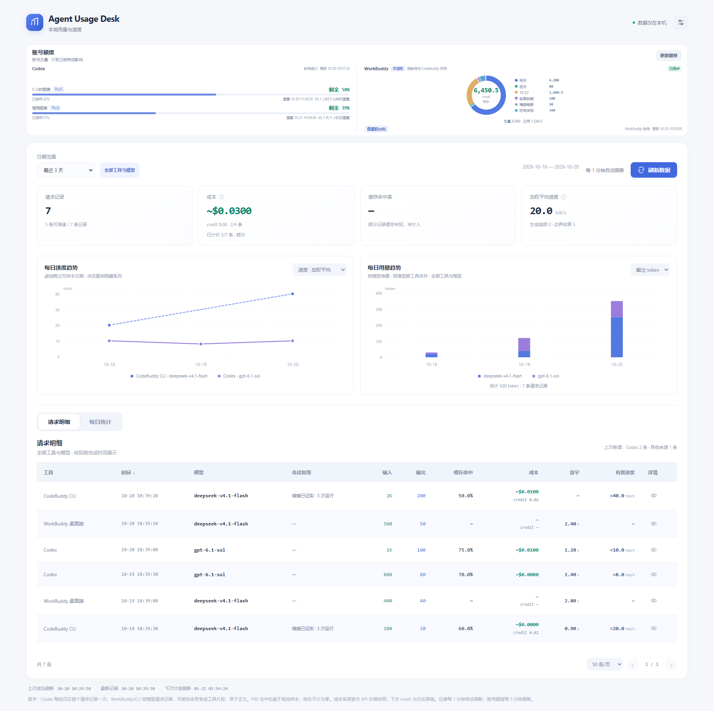

# Agent Usage Desk

> 基于 Windows 环境开发，目前仅支持 Windows；macOS/Linux 未适配。

Agent Usage Desk 是一个本地运行的用量仪表盘：读取本机 Codex、WorkBuddy 桌面端与 CodeBuddy CLI 的日志，汇总请求记录、输出速度、首字延迟、缓存命中与参考成本，并展示已登录账号的额度。当前版本 0.3.2，以 Chrome 扩展 + 本机读取器（Native Messaging）的形式工作。

项目在 Windows 10、PowerShell 7 环境开发与验证。扩展声明的最低 Chrome 版本为 120，未逐一验证所有后续版本；macOS/Linux 未适配。源码构建还需要 Python 3.12 与 Windows 自带的 .NET Framework 编译器；测试需要 Node 24，可选的界面测试需要 Playwright Chromium。当前通过“加载已解压的扩展程序”安装。

项目地址：https://github.com/JSbiu/agent-usage-desk



截图来自 Windows 上运行的 Chromium 界面检查，使用合成数据，不包含真实账号或使用记录。

## 功能

- **多来源汇总**：Codex、WorkBuddy 桌面端、CodeBuddy CLI 的请求记录统一展示，日期、卡片和图表默认统计全部工具与模型。
- **用量与速度**：请求数、输入/输出 token、缓存命中率、加权平均速度，以及首字延迟的中位数与 P90；样本缺失时不按 0 计算。
- **每日趋势**：速度/响应趋势与按模型堆叠的用量趋势，支持点击图例隐藏系列。
- **参考成本**：按固定版本的官方 API 价格快照估算，可切换 USD/CNY 显示（固定 1 USD = 6.8 CNY）；未知价格显示为未知，不计为零。
- **账号额度**：Codex 订阅额度通过本机 `codex app-server` 的 `account/rateLimits/read` 读取；WorkBuddy 个人账号积分与积分包通过官方计费接口查询。额度每 5 分钟更新。
- **自动刷新**：记录默认每 1 分钟刷新，可在设置中改为 30 秒至 60 分钟。
- **本地优先**：原始日志只读，索引保存在本机 SQLite，不保存聊天正文，无遥测与云同步。

额度查询属于现有行为：安装并运行后，会对本机已登录的账号自动发起查询。当前代码没有单独的授权开关，也不能在设置中关闭额度查询，详见 [隐私说明](docs/privacy.md)。

## 安装（Windows）

1. 解压发布包，得到外层目录 `AgentUsageDesk`。
2. 在该目录打开 PowerShell，注册当前用户的本地读取器（无需管理员权限）：

   ```powershell
   pwsh -NoProfile -File .\install.ps1
   ```

   安装脚本会复制文件到 `%LOCALAPPDATA%\CodexMonitor\app`，并写入当前用户的 Chrome Native Messaging 注册项 `com.codexmonitor.reader`。脚本结束时会打印扩展目录与扩展 ID。
3. 打开 `chrome://extensions`，启用“开发者模式”，点击“加载已解压的扩展程序”，选择：

   ```text
   %LOCALAPPDATA%\CodexMonitor\app\extension
   ```

4. 打开扩展面板即可查看数据。若没有发现某个来源，请在设置中确认对应日志目录，或直接留空使用默认位置。

扩展 ID 由 `manifest.json` 中的公钥固定。覆盖升级后，请在 `chrome://extensions` 中重新加载扩展，再打开看板。

## 从源码构建

要求：Windows、Python 3.12、可用的 .NET Framework 4 编译器（`C:\Windows\Microsoft.NET\Framework64\v4.0.30319\csc.exe`）。构建只使用 Python 标准库，不需要 `pip install`。

```powershell
python --version   # 应为 3.12.x
python .\scripts\build.py
```

产物：

- `dist\AgentUsageDesk\`：可直接安装的目录（内含 `CodexMonitorHost.exe`、`extension`、`native`、`runtime`、`docs`、`LICENSE`、`THIRD-PARTY.md`）。
- `dist\AgentUsageDesk-0.3.2-windows.zip`：同一目录的压缩包。

安装目录名 `CodexMonitor`、主机名 `com.codexmonitor.reader` 与 `CodexMonitorHost.exe` 是兼容性标识，构建与安装时不会改名。

## 测试

```powershell
# Python 单元测试（需要 Python 3.12）
$env:PYTHONPATH = (Resolve-Path .\native).Path
python -m unittest discover -s tests -p "test_*.py" -v

# Node 内置测试（需要 Node；开发时使用 Node 24）
node --test tests/background.test.mjs tests/buddy.test.mjs tests/quota-ring.test.mjs tests/usage-chart.test.mjs
```

可选的界面测试使用合成数据，不读取真实日志或账号：

```powershell
python -m pip install playwright
python -m playwright install chromium
python .\tests\ui_v032.py
```

`tests/ui_v032.py` 是当前唯一的界面测试脚本，截图输出到 `artifacts\screenshots`。

## 卸载

```powershell
pwsh -NoProfile -File "$env:LOCALAPPDATA\CodexMonitor\app\uninstall.ps1"
```

脚本会删除当前用户的注册项与 `app` 目录，随后请在 `chrome://extensions` 中移除扩展。历史索引与额度缓存仍保留在 `%LOCALAPPDATA%\CodexMonitor`，如不再需要可手动删除该目录。

## 隐私与限制

- 只读取本机日志：Codex 默认 `~/.codex`、WorkBuddy 默认 `~/.workbuddy/projects`、CodeBuddy CLI 默认 `~/.codebuddy/projects`；索引与配置位于 `%LOCALAPPDATA%\CodexMonitor`。
- 索引不保存聊天正文，但会保存时间、模型、token、耗时、会话编号与文件路径等元数据。
- WorkBuddy 额度查询会只读打开其登录凭据文件，仅向三个固定的官方计费地址发起请求，不刷新令牌；令牌不缓存、不写日志、不返回给前端。
- Codex 额度通过本机 `codex app-server` 读取，网络访问由 Codex 自身完成。
- 仅支持 WorkBuddy 个人账号；企业版或其他账号类型会明确提示不支持。
- 错误或未知数据保持“未知”，不会记为零；过期额度会标注为上次结果。
- 成本是固定价格快照的参考值，不代表实际账单、订阅余额或服务端计费。
- CLI 续接证据桥接目录（默认 `%LOCALAPPDATA%\CodexDeepSeek\runs`）是可选的本地开发桥接，不属于腾讯 CLI 的标准功能；不安装它也能使用其他统计，缺少证据时显示未知。
- 本项目为非官方个人项目，与 OpenAI、腾讯、DeepSeek 等无隶属或背书关系。

完整说明见 [docs/privacy.md](docs/privacy.md)；价格口径见 [docs/pricing.md](docs/pricing.md)。

## 目录导航

| 路径 | 说明 |
|---|---|
| `extension/` | Chrome 扩展（manifest、仪表盘、后台协调器） |
| `native/codex_monitor/` | Python 本地读取器：日志解析、SQLite 索引、额度与计价 |
| `launcher/Launcher.cs` | Native Messaging 的隐藏窗口启动器 |
| `scripts/build.py` | Windows 打包脚本 |
| `scripts/install.ps1` / `uninstall.ps1` | 当前用户安装与卸载 |
| `tests/` | Python 单元测试、Node 内置测试与界面测试 |
| `docs/` | 隐私、开发、第三方与价格说明 |
| `AGENTS.md` | 公开仓库的协作与数据保护约定 |

## 许可

本项目以 [MIT License](LICENSE) 发布，Copyright (c) 2026 JSbiu。第三方组件与运行时分发说明见 [docs/third-party.md](docs/third-party.md)。
